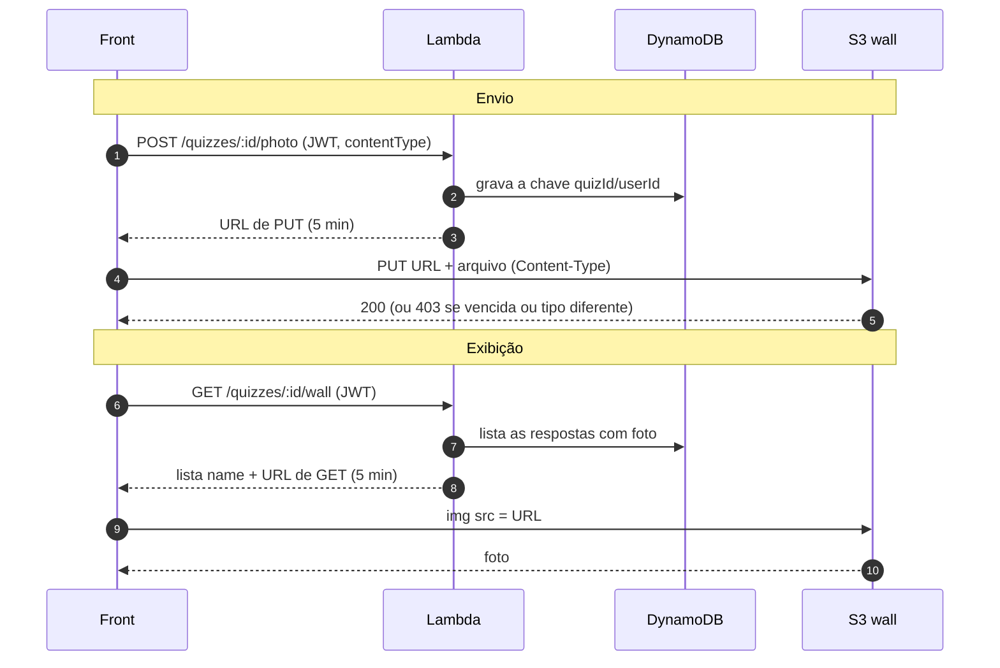

# Mural

Envio e exibição das fotos do mural. O navegador fala direto com o S3 usando URLs pré-assinadas geradas pela Lambda.

## Peças

- **Bucket `wall`** privado, com Block Public Access ligado [1]. Cada foto fica na chave `quizId/userId`.
- **Lambda**: única peça com permissão no bucket. Ela gera as URLs pré-assinadas; a URL carrega a permissão de quem assinou [2].
- **CORS no bucket**: libera o `PUT` vindo do front, com o header `Content-Type` [3].
- **DynamoDB**: guarda a chave da foto no item da resposta do usuário.

## Fluxo

## Envio

1. O front chama `POST /quizzes/:id/photo` com o JWT e `{ "contentType": "image/png" }` no corpo.
2. A Lambda aceita só JPG, PNG ou WebP, grava a chave da foto no DynamoDB e devolve uma URL de `PUT` válida por 5 minutos [4].
3. O front envia o arquivo direto ao S3 com `PUT` na URL e o header `Content-Type` [5].
4. O S3 confere a assinatura. URL vencida ou `Content-Type` diferente do assinado recebe `403`.

A foto não passa pela Lambda: o payload síncrono da Lambda tem limite de 6 MB [6], e ela só cobra pelos milissegundos que leva para assinar.

## Exibição

1. O front chama `GET /quizzes/:id/wall` com o JWT.
2. A Lambda devolve a lista `{ name, url }`, com uma URL de `GET` por foto, válida por 5 minutos [7].
3. O `` baixa cada foto do S3. Essa leitura não depende de CORS [8].

## CORS

O upload é um `PUT` de outra origem (o site) para o domínio do S3, então o navegador pergunta antes ao bucket se pode enviar [8]. A regra libera só o necessário:

| Campo | Valor | Motivo |
|---|---|---|
| `allowed_methods` | `PUT` | único método que o navegador usa no bucket |
| `allowed_origins` | `http://localhost:5173` | front local; o domínio do CloudFront entra na front-end-layer |
| `allowed_headers` | `Content-Type` | header enviado no `PUT` |

## Referências

1. [Blocking public access to your Amazon S3 storage](https://docs.aws.amazon.com/AmazonS3/latest/userguide/access-control-block-public-access.html)
2. [Download and upload objects with presigned URLs](https://docs.aws.amazon.com/AmazonS3/latest/userguide/using-presigned-url.html)
3. [Configuring CORS](https://docs.aws.amazon.com/AmazonS3/latest/userguide/ManageCorsUsing.html)
4. [Uploading objects with presigned URLs](https://docs.aws.amazon.com/AmazonS3/latest/userguide/PresignedUrlUploadObject.html)
5. [Content-Type, MDN](https://developer.mozilla.org/en-US/docs/Web/HTTP/Reference/Headers/Content-Type)
6. [Lambda quotas](https://docs.aws.amazon.com/lambda/latest/dg/gettingstarted-limits.html)
7. [Sharing objects with presigned URLs](https://docs.aws.amazon.com/AmazonS3/latest/userguide/ShareObjectPreSignedURL.html)
8. [CORS, MDN](https://developer.mozilla.org/en-US/docs/Web/HTTP/Guides/CORS)
9. [Creating diagrams, GitHub](https://docs.github.com/en/get-started/writing-on-github/working-with-advanced-formatting/creating-diagrams)
